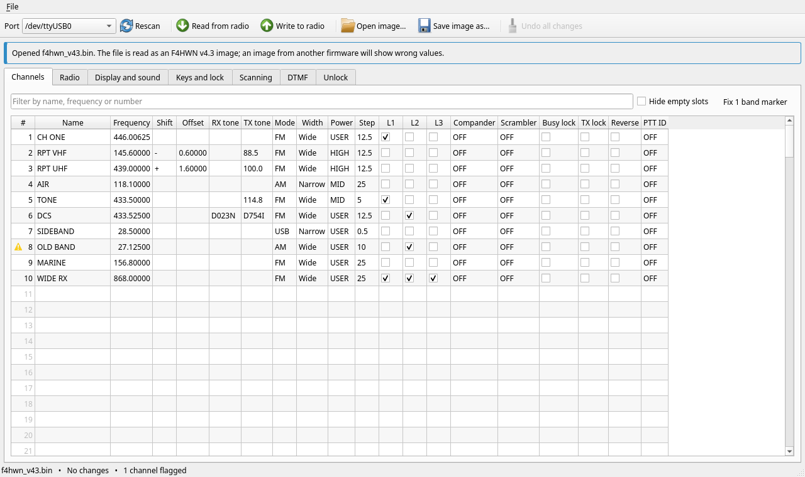

# K5 Editor

[](https://github.com/audric/k5editor/actions/workflows/build.yml)

A desktop editor for the memory channels and settings of a Quansheng UV-K5 handheld
running the **F4HWN v4.3** firmware. C++20 and Qt 6, for Linux and Windows.



## What it does

- Reads the radio over the usual programming cable (38400 baud) and shows the 200
  memory channels in an editable table: name, frequency, shift and offset, RX/TX tones,
  mode, width, power, step, the three scan lists and the other per-channel options.
- Edits the radio's settings, grouped as Radio, Display and sound, Keys and lock,
  Scanning, DTMF and Unlock.
- Adds ready-made channel lists into empty slots, optionally into one of the scan lists:
  CB 27 MHz (FM and AM), marine VHF, PMR446, LPD433, Freenet, Italian 43 MHz, KDR444,
  FRS/GMRS, MURS, NOAA weather, amateur calling frequencies, distress frequencies and
  the tower, approach, ground and ATIS frequencies of Italian airports (three lists:
  north, centre, south and islands; data from [OurAirports](https://ourairports.com/data/),
  public domain). Air band channels are added with TX lock on.
- Adds Italian amateur FM repeaters, one list per region (2 m and 70 cm, with shift and
  access tone), and the amateur FM satellites and ISS with Doppler steps.
- The lists are plain CSV files in [`lists/`](lists/README.md). Keep your own in
  `~/.local/share/k5editor/lists/`, or `%LOCALAPPDATA%\k5editor\lists\` on Windows
  (*Open my lists folder* in the dialog): a new file adds a list, a file named like a
  shipped one replaces it.
- Flags channels whose stored data looks damaged or was left by another firmware.
- Opens and saves 8 KiB memory images, and starts new ones with no channels and default
  settings (*File → New*).

## How it protects the radio

- Before every write it saves the radio's current memory to a dated backup file.
- It writes only the 8-byte blocks that changed, then reads the radio back and compares.
  The radio is restarted only if that check passes.
- It never writes the calibration area (`0x1D00`-`0x1FF1`).
- It refuses to write to any firmware other than F4HWN v4.3, because other firmwares
  store the same settings differently.
- If the radio changed the same memory since it was read (for example through its own
  menu), the write stops and asks.
- `UNLOCK ALL` for the TX frequency lock cannot be switched on from the program, as in
  the firmware author's own CHIRP driver. Do that in the radio's menu.

## Supported hardware and firmware

| | |
|---|---|
| Radio | Quansheng UV-K5 / UV-K5(8) / UV-K6 with the DP32G030 chip |
| Firmware | F4HWN v4.3 (any edition) |
| System | Linux, or Windows 10 / 11 (64-bit) |

Other firmwares can be read and saved to a file as a backup, but not edited or written.

## Install

Current release: **v0.3.0** ([all releases](https://github.com/audric/k5editor/releases)).
The packages are built by GitHub.

### Linux

There are packages for PCs (`amd64`) and for Raspberry Pi (`arm64`, 64-bit Raspberry
Pi OS). They need Debian 12, Raspberry Pi OS Bookworm, Ubuntu 24.04, or newer.

On a PC:

```sh
wget https://github.com/audric/k5editor/releases/download/v0.3.0/k5editor_0.3.0_amd64.deb
sudo apt install ./k5editor_0.3.0_amd64.deb
```

On a Raspberry Pi:

```sh
wget https://github.com/audric/k5editor/releases/download/v0.3.0/k5editor_0.3.0_arm64.deb
sudo apt install ./k5editor_0.3.0_arm64.deb
```

Then start **K5 Editor** from the applications menu, or run `k5editor`. `apt` installs
the Qt 6 libraries it needs.

Each release also has a `.tar.gz` per architecture with the same program and no
installer; it needs the Qt 6 libraries (`libqt6widgets6`) already installed.

Your user needs access to the serial port, usually by being in the `dialout` group.

### Windows

Download
[`k5editor-0.3.0-windows-x64.zip`](https://github.com/audric/k5editor/releases/download/v0.3.0/k5editor-0.3.0-windows-x64.zip),
unpack it anywhere and start `k5editor.exe` from the unpacked folder. There is no
installer, and the folder already holds the Qt libraries.

The program is not signed, so Windows may show a "Windows protected your PC" notice the
first time: choose *More info*, then *Run anyway*.

The programming cable shows up as a `COM` port. If none is listed, install the driver
for the cable's USB chip (CH340 on most cables).

## Build

On Debian or Ubuntu:

```sh
sudo apt install g++ cmake ninja-build qt6-base-dev
cmake -S . -B build -G Ninja
cmake --build build
ctest --test-dir build        # optional: runs the core tests
./build/k5editor
```

To make the packages yourself: `cd build && cpack -G "DEB;TGZ"`.

On Windows, install Qt 6 for MinGW with the Qt installer, run the same `cmake`
commands from the Qt command prompt, and make the zip with `cd build && cpack -G ZIP`.

## Use

1. Connect the programming cable, switch the radio on, and press **Read from radio**.
2. Edit channels (double-click a cell) and settings. Changed values are shown in bold.
   **Add channel lists…** fills empty slots from the ready-made lists; the radio holds
   200 channels, so pick the lists you need.
3. Press **Write to radio**. The program lists the changes and asks before sending them.

Backups go to `~/.local/share/k5editor/backups`, or
`%LOCALAPPDATA%\k5editor\k5editor\backups` on Windows; change that under
*File → Choose backup folder*.

Command line:

```sh
k5editor image.bin                     # open an image file
k5editor --dump /dev/ttyUSB0 out.bin   # read the radio to a file, without a window
k5editor --dump COM3 out.bin           # the same on Windows
```

## Not included

DTMF contacts, FM broadcast presets, calibration editing, the VFO state and firmware
flashing. The side-key action lists show every action the firmware family knows,
including ones a given edition was built without.

## Status

The core (packet format, memory layout, write planning and the write procedure) is
covered by automated tests that run against a simulated radio. Reading has been checked
against a real UV-K5 on F4HWN v4.3.

Release packages are built and tested by GitHub for Linux on both architectures and
for Windows. The `arm64` package has not yet been tried on an actual Raspberry Pi, and
the Windows package has not yet been tried with a real radio.

Use it at your own risk: it writes to your radio's memory. Keep the first backup it
makes; that file also contains your radio's calibration.

## Credits and licence

The memory layout was transcribed from the CHIRP driver for the Egzumer/F4HWN firmware
(`uvk5_egzumer_f4hwn_ver_4_3_0.py`, © Jacek Lipkowski SQ5BPF, Egzumer, JOC2 and others,
GPL v2 or later), which builds on SQ5BPF's reverse engineering of the UV-K5 protocol.
F4HWN firmware is by Armel F4HWN: <https://github.com/armel/uv-k5-firmware-custom>.

K5 Editor is free software under the GNU General Public License, version 3 or later.
See [LICENSE](LICENSE).
